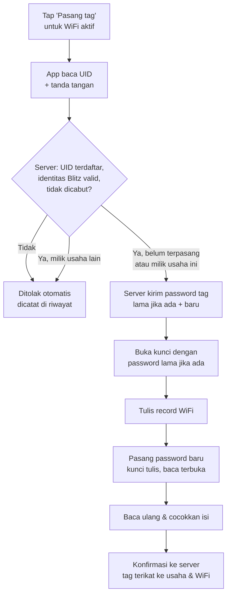
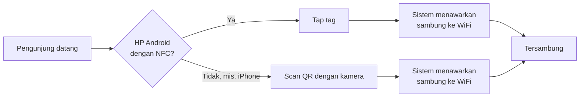
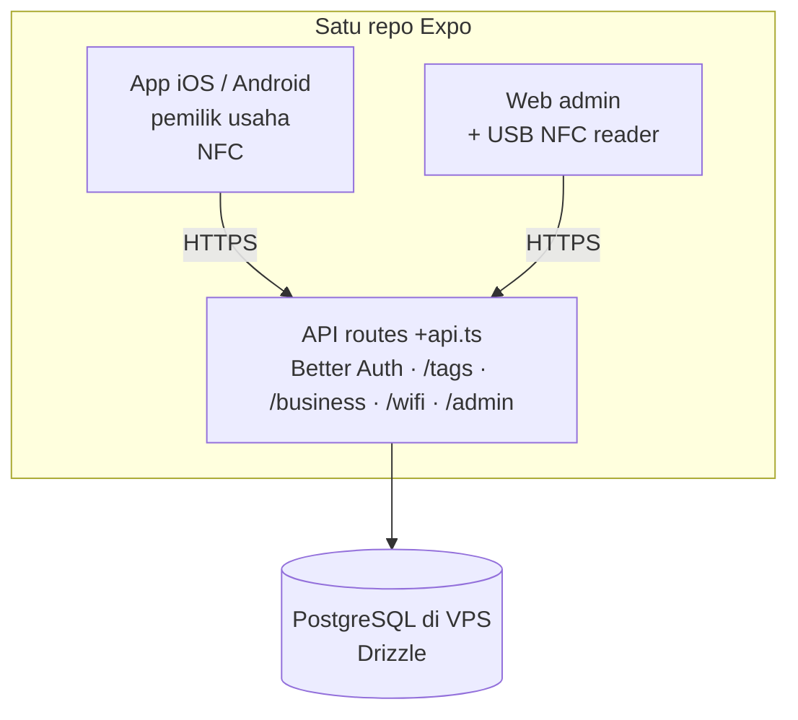

# Blitz — Legacy PRD / Migration Source

Status: **Legacy; non-authoritative** · Product source of truth: `../../docs/PRD.md`.

This file is retained only as an archive during migration. It contains obsolete architecture and product statements. Do not use it to guide implementation or resolve decisions. The sole product source of truth is `../../docs/PRD.md`; verified mobile implementation constraints belong in `architecture.md` and `AGENTS.md`.

## 1. Ringkasan & tujuan

Blitz membuat pengunjung tersambung ke WiFi publik sebuah usaha cukup dengan sekali tap tag NFC, dengan QR code sebagai cadangan. Tag adalah produk fisik Blitz (NTAG215) yang didaftarkan admin sebelum dijual. Pemilik usaha memakai app mobile Blitz untuk memasang (provisioning) konfigurasi WiFi ke tag; tag otomatis dikunci di background dengan password yang diturunkan server dari PIN usaha + UID tag. Admin Blitz mengelola pengguna dan tag lewat web.

**Masalah:** pengunjung harus bertanya password WiFi lalu mengetiknya manual. Pemilik usaha mengulang informasi yang sama setiap hari, dan password yang ditempel di dinding mudah salah ketik atau usang.

**Tujuan v1:**

- Pemilik usaha menyelesaikan onboarding (profil usaha opsional → PIN → minimal 1 WiFi) dan memasang tag pertamanya dalam satu sesi tanpa bantuan.
- Usaha besar bisa punya banyak WiFi; app menampilkan satu WiFi aktif dengan switcher, mirip multi-tenant.
- Hanya tag yang didaftarkan oleh admin Blitz dan memiliki identitas Blitz yang valid yang bisa di-provisioning; tag yang tidak terdaftar, dicabut, atau memiliki identitas Blitz tidak valid otomatis ditolak.
- Identitas Blitz adalah bukti bahwa data/identitas tag diterbitkan Blitz, bukan bukti bahwa IC dibuat oleh NXP. V1 tidak menolak tag semata-mata karena originality signature NXP tidak tersedia/valid; batas anti-kloning NTAG215 tetap dinyatakan.
- Tag dikunci tulis sehingga tidak bisa ditimpa orang lain; membaca tetap terbuka untuk pengunjung.
- Pengunjung Android tersambung hanya dengan tap; pengunjung iPhone dan HP tanpa NFC lewat scan QR.

**Usulan metrik sukses:** waktu onboarding sampai tag pertama terpasang, % provisioning berhasil di percobaan pertama, jumlah percobaan provisioning dengan tag tidak terdaftar/tidak asli.

## 2. Pengguna & peran

| Peran                    | Platform                                      | Butuh akun           | Yang dilakukan                                                  |
| ------------------------ | --------------------------------------------- | -------------------- | --------------------------------------------------------------- |
| **Admin** (tim Blitz)    | **Web saja** — tidak bisa login di app mobile | Ya, role `admin`     | Daftarkan tag sebelum dijual, kelola pengguna, pantau aktivitas |
| **Pemilik usaha** (user) | App iOS / Android saja                        | Ya, 1 orang per akun | Onboarding, kelola WiFi, provisioning tag, tampilkan QR         |
| **Pengunjung**           | HP apa saja                                   | Tidak, tanpa app     | Tap tag NFC atau scan QR untuk tersambung                       |

## 3. Fitur mobile (pemilik usaha)

| #   | Fitur                                                                                     | Prioritas | Catatan                                                                                                                                                       |
| --- | ----------------------------------------------------------------------------------------- | --------- | ------------------------------------------------------------------------------------------------------------------------------------------------------------- |
| M1  | Daftar & login: email/password + Google                                                   | Must      | Better Auth; verifikasi email & reset password (selama development, link dicetak di console server)                                                           |
| M2  | Onboarding 1/3: profil usaha (nama + foto)                                                | Could     | **Opsional — bisa dilewati** dan diisi nanti                                                                                                                  |
| M3  | Onboarding 2/3: set PIN usaha (6 digit) + konfirmasi                                      | Must      | Tidak perlu dihafal: dipakai otomatis di background untuk mengunci tag                                                                                        |
| M4  | Onboarding 3/3: set WiFi pertama (label, SSID, password, keamanan WPA2/WPA3/open, hidden) | Must      | Minimal 1 WiFi wajib                                                                                                                                          |
| M5  | Tambah/edit/hapus WiFi & switcher WiFi aktif                                              | Must      | App menampilkan 1 WiFi aktif beserta tag & QR-nya; pindah lewat switcher                                                                                      |
| M6  | Provisioning tag ke WiFi aktif                                                            | Must      | Baca UID → cek server (UID terdaftar, identitas Blitz valid, tidak dicabut) → tulis WiFi + kunci tulis → baca ulang → konfirmasi ke server                    |
| M7  | Re-provisioning                                                                           | Must      | Saat password WiFi berubah atau tag dipindah ke WiFi lain; server memberi password tag lama untuk membuka kunci, lalu password baru                           |
| M8  | Cek tag: status & isinya                                                                  | Should    | Terdaftar? Validasi identitas Blitz? Milik akun ini? Berisi WiFi apa?                                                                                         |
| M9  | QR code WiFi                                                                              | Must      | Format `WIFI:T:<WPA\|nopass>;S:<ssid>;P:<password>;H:<true\|false>;;` dengan karakter `\ ; , : "` di-escape; bisa dibagikan/dicetak                           |
| M10 | Ganti PIN usaha                                                                           | Should    | Butuh konfirmasi ulang identitas (password akun, atau login Google ulang untuk akun Google); tag lama pindah ke password baru saat re-provisioning berikutnya |
| M11 | Hapus akun dari dalam app                                                                 | Must      | Wajib menurut App Store & Google Play; tag milik akun dilepas kembali ke status _terdaftar_                                                                   |

Akun dengan role `admin` ditolak saat login di app mobile.

## 4. Fitur web (admin)

| #   | Fitur                                                                    | Prioritas | Catatan                                                                                                                                                                                                                  |
| --- | ------------------------------------------------------------------------ | --------- | ------------------------------------------------------------------------------------------------------------------------------------------------------------------------------------------------------------------------ |
| W1  | Login admin                                                              | Must      | Better Auth plugin `admin` (role, ban, impersonate); web menolak akun non-admin                                                                                                                                          |
| W2  | Daftarkan tag                                                            | Must      | Per batch; UID lewat USB NFC reader mode keyboard (tap tag → UID terketik + Enter, beruntun), impor CSV, atau ketik manual. UID dinormalisasi ke hex 7 byte; UID ganda dan UID non-NXP (byte pertama bukan `04`) ditolak |
| W3  | Kelola pengguna: daftar, detail usaha, nonaktifkan/ban                   | Must      |                                                                                                                                                                                                                          |
| W4  | Kelola tag: status, cari per UID/batch/usaha, cabut, lepas dari usaha    | Must      | Untuk tag hilang/dicuri/dicurigai                                                                                                                                                                                        |
| W5  | Riwayat aktivitas tag: didaftarkan, dicek, terpasang, ditolak, dicurigai | Must      | Termasuk percobaan dengan tag tidak terdaftar                                                                                                                                                                            |
| W6  | Dashboard ringkas: jumlah pengguna, tag terdaftar/terpasang, penolakan   | Should    |                                                                                                                                                                                                                          |

Browser tidak bisa mengirim perintah NFC mentah, jadi web hanya mendaftarkan UID. Identitas Blitz diverifikasi oleh app pemilik usaha saat provisioning dengan public key Blitz (§8).

## 5. Alur utama

**Onboarding (pemilik usaha):**

1. Daftar/login (email atau Google).
2. Profil usaha: nama + foto — bisa dilewati.
3. Set PIN 6 digit (+ konfirmasi).
4. Set WiFi pertama.
5. Masuk ke beranda dengan WiFi pertama sebagai WiFi aktif, siap provisioning.

**Provisioning tag:**

Pemilik tidak pernah melihat atau mengetik PIN di proses ini. Bila konfirmasi akhir gagal karena koneksi, app mengulangnya otomatis.

**Pengunjung tersambung:**

**Pendaftaran tag (admin di web, sebelum dijual):** halaman Tag → pilih/isi batch → tap tag satu per satu di USB NFC reader (atau impor CSV) → tiap UID tersimpan sebagai _terdaftar_; UID ganda/tidak valid ditolak dan ditampilkan.

## 6. Model data

App sepenuhnya online: semua data ada di server (PostgreSQL); HP tidak menyimpan DB lokal. Session login disimpan di SecureStore.

| Tabel                                        | Kolom utama                                                                                                                               | Catatan                                                                                                                                                            |
| -------------------------------------------- | ----------------------------------------------------------------------------------------------------------------------------------------- | ------------------------------------------------------------------------------------------------------------------------------------------------------------------ |
| `user`, `session`, `account`, `verification` | Dibuat Better Auth (+ `role`, `banned` dari plugin admin)                                                                                 |                                                                                                                                                                    |
| `business`                                   | `userId` (unik), `name`?, `photoUrl`?, `pin` (terenkripsi), `activeWifiId`                                                                | PIN dibaca server untuk menurunkan password tag; tidak pernah dikirim ke app                                                                                       |
| `wifi_config`                                | `businessId`, `label`, `ssid`, `password` (terenkripsi), `security`, `hidden`                                                             | Banyak per usaha, minimal 1                                                                                                                                        |
| `tag`                                        | `uid` (unik), `batch`, `status`, `signature`, `businessId`, `wifiConfigId`, `lockPassword` (terenkripsi), `registeredAt`, `provisionedAt` | Status: _terdaftar_ / _terpasang_ / _dicabut_ / _dicurigai_. `signature` direkam saat provisioning pertama. `lockPassword` = password yang sedang terpasang di tag |
| `tag_event`                                  | `tagUid`, `type`, `userId`, `result`, `createdAt`                                                                                         | Riwayat untuk W5                                                                                                                                                   |

QR tidak disimpan — dibuat dari `wifi_config` saat ditampilkan.

**API utama:**

| Endpoint                     | Fungsi                                                                                                                |
| ---------------------------- | --------------------------------------------------------------------------------------------------------------------- |
| `POST /api/tags/check`       | UID + tanda tangan → tolak, atau izin + password lama/baru + konfigurasi WiFi aktif. Juga dipakai M8 (tanpa password) |
| `POST /api/tags/provisioned` | Konfirmasi setelah tag ditulis                                                                                        |
| `POST /api/admin/tags`       | Daftar tag, satuan atau batch CSV                                                                                     |
| `/api/auth/*`                | Better Auth                                                                                                           |
| `/api/business`, `/api/wifi` | CRUD usaha & WiFi                                                                                                     |

## 7. Arsitektur teknis

Satu repo Expo menghasilkan app iOS, app Android, web admin, dan API. Yang di-deploy ke VPS hanya hasil `npx expo export` (web + API routes) yang dijalankan dengan `expo-server` (adapter Bun/Express).

| Lapisan       | Pilihan                                                                                                               |
| ------------- | --------------------------------------------------------------------------------------------------------------------- |
| App           | Expo SDK 57, Expo Router, `@expo/ui`                                                                                  |
| NFC           | `react-native-nfc-manager@4.0.0-beta.9` + config plugin, entitlement `TAG` saja (butuh development build) — lihat §12 |
| Auth          | Better Auth (`better-auth`, `@better-auth/expo`, `expo-secure-store`), plugin `admin`                                 |
| Data di app   | Panggil API langsung (online); `expo-network` untuk status "tidak ada koneksi"                                        |
| DB            | PostgreSQL + Drizzle (driver `postgres`) — hanya di server                                                            |
| Kripto server | HMAC-SHA256 (password tag), `@noble/curves` (verifikasi tanda tangan NXP)                                             |
| Web           | Expo Router web, `web.output: "server"`                                                                               |
| Deploy        | VPS, `expo-server` (Bun)                                                                                              |

## 8. Kebutuhan non-fungsional & batasan NFC

**Online**

- Semua fitur butuh internet. Tanpa koneksi, app menampilkan status jelas dan tombol coba lagi — tidak ada mode offline.
- Tag hanya ditulis setelah server mengizinkan; bila konfirmasi akhir gagal, app mengulangnya otomatis (tag sudah tertulis, server belum tahu).

**Platform & NFC**

- Menulis tag (pemilik usaha): Android dengan NFC; iPhone 7 ke atas (iOS 13+). App butuh development build, bukan Expo Go.
- Pengunjung: Android menawarkan sambung WiFi dari tag secara bawaan; **iPhone tidak bisa auto-join WiFi dari NFC**, jadi memakai QR (§12).
- Perilaku "tap → sambung" di Android bervariasi antar merek — diuji di ≥2 merek pada spike.

**Kunci tulis tag**

- Password tag = `HMAC-SHA256(SERVER_SECRET, PIN ‖ UID)` dipotong 6 byte → `PWD` (4 byte) + `PACK` (2 byte), dihitung di server. Setiap tag punya password berbeda walau PIN sama.
- `SERVER_SECRET` wajib: tanpa itu, PIN 6 digit hanya 1 juta kombinasi dan bisa dicoba langsung di tag dalam hitungan jam.
- Proteksi hanya untuk tulis (`PROT = 0`); membaca selalu terbuka.
- `AUTHLIM = 0` (tidak dibatasi): batas salah password justru memungkinkan orang iseng mengunci tag permanen; aman karena password tidak bisa ditebak tanpa `SERVER_SECRET`.
- Ganti PIN tidak membuat tag terkunci: server menyimpan password yang sedang terpasang (`tag.lockPassword`), dan tag pindah ke password baru saat re-provisioning berikutnya.
- Password NTAG terkirim tanpa enkripsi saat membuka kunci; risiko penyadapan jarak dekat saat re-provisioning diterima untuk v1.

**Keaslian tag**

- Provisioning hanya diizinkan bila UID ada di registry, tidak dicabut, tidak terikat ke usaha lain, **dan** tanda tangan originality NXP (`READ_SIG`) valid terhadap public key NXP untuk UID itu.
- Tanda tangan direkam saat provisioning pertama; bila UID yang sama kelak datang dengan tanda tangan berbeda, server menolak dan mengubah status tag menjadi _dicurigai_.

**Keamanan**

- Password WiFi dan PIN disimpan terenkripsi di server (PIN tidak di-hash karena dipakai otomatis), tidak pernah ditampilkan polos di web, dan PIN tidak pernah dikirim ke app.
- Konsekuensi: akun yang dibobol bisa memasang ulang tag milik usaha itu. Mitigasi: verifikasi email, rate limit, konfirmasi ulang identitas untuk ganti PIN.
- Rate limit pada `/api/tags/*` dan endpoint auth; ikuti skill `better-auth-security-best-practices`.

**Lainnya**

- Bahasa: Indonesia dulu.
- Aksesibilitas: label pembaca layar untuk tombol NFC/QR, kontras cukup.
- UI native, bukan gaya web (aturan UI di `AGENTS.md`).

## 9. Di luar cakupan v1

- Mode offline.
- Analitik pengunjung (berapa kali tag di-tap) — tap WiFi tidak menyentuh server.
- Captive portal, login pengunjung, iklan di WiFi.
- Beberapa staf per akun usaha.
- Pembayaran/langganan.
- Web untuk pemilik usaha; app mobile untuk admin.
- Sign in with Apple — **wajib ditambahkan sebelum rilis App Store** karena ada login Google.

## 10. Keputusan, pertanyaan terbuka & risiko

**Sudah diputuskan:**

| Topik             | Keputusan                                                                                 |
| ----------------- | ----------------------------------------------------------------------------------------- |
| Chip              | NTAG215 asli NXP                                                                          |
| Koneksi           | App sepenuhnya online                                                                     |
| Peran             | Admin hanya web; app mobile hanya pemilik usaha                                           |
| Onboarding        | Profil usaha (opsional) → PIN 6 digit → minimal 1 WiFi                                    |
| PIN               | Bisa diganti, dipakai otomatis di background, tidak perlu dihafal                         |
| WiFi              | Banyak per usaha, satu aktif dengan switcher                                              |
| Keaslian tag      | Registry UID + tanda tangan NXP diverifikasi saat provisioning; tag terikat ke satu usaha |
| Data sensitif     | Password WiFi & PIN disimpan terenkripsi di server                                        |
| Pengunjung iPhone | QR                                                                                        |
| Auth              | Better Auth, email/password + Google                                                      |

**Pertanyaan terbuka (ditunda, tidak menghalangi fase mobile):**

| #   | Pertanyaan                                       | Status                                         |
| --- | ------------------------------------------------ | ---------------------------------------------- |
| Q8  | Penyedia email untuk verifikasi & reset password | Fase web. Development: link dicetak di console |
| Q9  | Cara membuat akun admin pertama                  | Fase web. Sementara: script seed               |
| Q10 | Penyimpanan foto usaha                           | Ditunda (profil opsional). Usul: folder di VPS |

**Risiko utama:**

| Risiko                                                    | Mitigasi                                                      |
| --------------------------------------------------------- | ------------------------------------------------------------- |
| Library NFC untuk New Architecture masih beta             | Pin versi, uji menyeluruh di spike (§12)                      |
| Stok tag ternyata bukan NXP asli                          | Uji tanda tangan stok produksi di spike                       |
| Perintah NFC beruntun tidak stabil di iPhone              | Uji ≥10 kali berturut-turut di spike                          |
| Tag dikloning (kartu "magic" menyalin UID + tanda tangan) | Tag terikat ke satu usaha; tanda tangan berbeda → _dicurigai_ |
| Akun dibobol lalu tag dipasang ulang                      | Verifikasi email, rate limit, konfirmasi ulang identitas      |
| Koneksi putus di tengah provisioning                      | Konfirmasi diulang otomatis                                   |

## 11. Milestone

1. **Spike NFC** — checklist §12. Lolos semua = lanjut; gagal di satu poin = PRD ditinjau ulang.
2. **Fondasi** — Better Auth (email + Google, plugin admin), Postgres + Drizzle, API route auth, server bisa diakses dari HP (VPS atau tunnel saat development).
3. **Registry tag (sementara)** — tabel `tag` diisi lewat script seed/CSV; `POST /api/tags/check` dengan verifikasi tanda tangan NXP; `tag_event`.
4. **Onboarding & WiFi** — profil usaha opsional (tanpa foto dulu, menunggu Q10), PIN, WiFi pertama, kelola WiFi, switcher.
5. **Provisioning** — pasang, re-provisioning, cek tag, QR, ganti PIN, hapus akun.
6. **Web admin** — login admin, daftar tag (USB reader / CSV), kelola pengguna & tag, riwayat, dashboard.
7. **Rilis** — Sign in with Apple, email produksi, uji perangkat, EAS build & submit.

## 12. Kelayakan teknis (riset 2026-10-01)

**Kesimpulan: layak dibangun.** Semua kebutuhan NFC (baca UID, tulis record WiFi, kunci tulis dengan password, baca tanda tangan originality) didukung oleh hardware NTAG215 dan oleh library di Android maupun iOS. Tiga risiko harus dibuktikan di spike: library masih beta, keaslian chip yang dibeli, dan keandalan perintah beruntun di iPhone.

**Library NFC — `react-native-nfc-manager`**

| Temuan                                                                                                                                                                                                                                                                  | Dampak                                                                          | Penanganan                                                                                                 |
| ----------------------------------------------------------------------------------------------------------------------------------------------------------------------------------------------------------------------------------------------------------------------- | ------------------------------------------------------------------------------- | ---------------------------------------------------------------------------------------------------------- |
| Versi stabil `3.17.2` hanya arsitektur lama; dukungan New Architecture ada di `4.0.0-beta.9` (rilis 2026-09-08)                                                                                                                                                         | Expo SDK 57 wajib New Architecture → harus pakai beta                           | Pin versi persis `4.0.0-beta.9`; uji menyeluruh di spike                                                   |
| Bug iOS: `getTag()` memanggil callback dua kali tanpa sesi aktif → crash di New Architecture ([#833](https://github.com/revtel/react-native-nfc-manager/issues/833), PR perbaikan [#836](https://github.com/revtel/react-native-nfc-manager/issues/836) belum di-merge) | App bisa crash                                                                  | Hanya panggil `getTag()` di dalam sesi `requestTechnology` aktif; tambal dengan `patch-package` bila perlu |
| Entitlement NDEF ditolak App Store ([#805](https://github.com/revtel/react-native-nfc-manager/issues/805))                                                                                                                                                              | Gagal submit iOS                                                                | Plugin `includeNdefEntitlement: false` (hanya `TAG`) — kita memang memakai perintah MIFARE mentah          |
| Config plugin hanya menaikkan `compileSdkVersion` ke 31, **bukan** minSdk (dicek dari source `app.plugin.js`)                                                                                                                                                           | Android lama tetap didukung                                                     | —                                                                                                          |
| Perintah mentah: Android `nfcAHandler.transceive()`, iOS `sendMifareCommandIOS()`                                                                                                                                                                                       | Cukup untuk `READ` (0x30), `WRITE` (0xA2), `PWD_AUTH` (0x1B), `READ_SIG` (0x3C) | Satu modul kecil `ntag215.ts` membungkus dua platform                                                      |
| Tidak ada helper record WiFi                                                                                                                                                                                                                                            | Payload Wi-Fi Simple Configuration dibuat sendiri                               | `Ndef.record()` dengan MIME `application/vnd.wfa.wsc` + TLV WSC (SSID, auth, encryption, network key)      |

Karena tag dikunci, record NDEF ditulis lewat `WRITE` per halaman setelah `PWD_AUTH` di sesi yang sama — bukan lewat `writeNdefMessage`.

**Hardware NTAG215**

- Memori user 504 byte; halaman terakhir 0x86 (keduanya terkonfirmasi di Proxmark3). Halaman konfigurasi (tata letak standar NTAG21x; datasheet belum dibaca langsung — **verifikasi di spike**): `0x83` CFG0 (`AUTH0`), `0x84` CFG1 (`PROT`, `AUTHLIM`), `0x85` `PWD`, `0x86` `PACK`. Kunci tulis saja: `PROT = 0`, `AUTH0 = 0x04`.
- Tanda tangan originality: ECDSA kurva **secp128r1** atas UID 7 byte, 32 byte, public key NXP NTAG21x `04494E1A386D3D3CFE3DC10E5DE68A499B1C202DB5B132393E89ED19FE5BE8BC61` (NXP AN11350). Node `crypto` tidak praktis untuk kurva ini tanpa hash → verifikasi di server memakai `@noble/curves` (kurva custom).
- ⚠️ Ada chip tiruan yang mengaku NTAG215 (mis. "Shanghai Feiju NTAG", tercatat di Proxmark3) dan kartu "magic" NTAG21x yang UID-nya bisa diubah. Tiruan murah gagal di cek tanda tangan — **pastikan stok tag Blitz adalah NXP asli** (diuji di spike). Kartu magic yang menyalin UID + tanda tangan lolos cek tanda tangan; mitigasinya tag terikat ke satu usaha dan status _dicurigai_ (§8).

**Platform**

|                                         | Android                             | iPhone                                                                                                           |
| --------------------------------------- | ----------------------------------- | ---------------------------------------------------------------------------------------------------------------- |
| Pengunjung tap tag → sambung WiFi       | ✅ Didukung bawaan (prompt sambung) | ❌ Tidak ada auto-join dari NFC → QR                                                                             |
| Pemilik: provisioning (perintah mentah) | ✅ `NfcA`                           | ✅ `NFCMiFareTag.sendMiFareCommand` (iOS 13+, iPhone 7+); developer melaporkan kadang putus di perintah beruntun |
| Syarat development                      | Development build                   | Development build + **Apple Developer Program berbayar** (NFC tidak tersedia untuk akun gratis/Personal Team)    |

**Checklist spike (milestone 1)**

- [ ] Development build Android & iOS dengan `react-native-nfc-manager@4.0.0-beta.9`, entitlement `TAG` saja
- [ ] Baca UID + `READ_SIG` di kedua platform; tanda tangan stok tag Blitz lolos verifikasi public key NXP
- [ ] Tulis record WiFi via `WRITE` per halaman; Android pengunjung tap → prompt sambung muncul (uji ≥2 merek)
- [ ] Set `PWD`/`PACK`/`AUTH0`/`PROT=0`; tulis tanpa password ditolak; baca tetap terbuka
- [ ] `PWD_AUTH` → tulis ulang → ganti password, di kedua platform
- [ ] iPhone: urutan perintah lengkap provisioning stabil (≥10 kali berturut-turut)
- [ ] QR WiFi dari app bisa di-scan kamera iPhone & Android
- [ ] (Fase web) USB NFC reader mode keyboard: format UID yang diketik (hex/desimal, urutan byte) sama dengan UID yang dibaca app

**Yang perlu disiapkan:** beberapa tag NTAG215 dari stok produksi, ≥2 HP Android dengan NFC (merek berbeda), 1 iPhone 7+, akun Expo, Apple Developer Program berbayar; untuk fase web, USB NFC reader mode keyboard.

Sumber: [react-native-nfc-manager](https://github.com/revtel/react-native-nfc-manager) (source v4.0.0-beta.9 dan issue di atas, juga via Context7) · [Proxmark3 `cmdhfmfu.c`](https://github.com/RfidResearchGroup/proxmark3/blob/master/client/src/cmdhfmfu.c) dan [`originality.c`](https://github.com/RfidResearchGroup/proxmark3/blob/master/client/src/crypto/originality.c) · [NXP NTAG213/215/216 datasheet](https://www.nxp.com/docs/en/data-sheet/NTAG213_215_216.pdf) · [iOS & WiFi NFC](https://priyashasetia.medium.com/i-bought-nfc-tags-to-share-my-wi-fi-heres-what-i-learned-about-what-they-can-and-can-t-do-45592ec915c2) · [iOS PWD_AUTH via sendMiFareCommand](https://developer.apple.com/forums/thread/763397) · [NFC butuh akun Apple berbayar](https://developer.apple.com/forums/tags/core-nfc)
